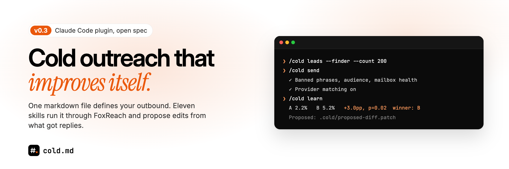

# cold.md - cold outreach that improves itself

[](LICENSE)
[](https://creativecommons.org/licenses/by/4.0/)
[](https://docs.claude.com/en/docs/claude-code/plugins)
[](https://cold.md)

An open spec for describing your outbound as one markdown file, and a Claude Code plugin that runs it. Eleven skills, one `/cold` command: ICP, offer, lead sourcing, verification, drafting, sending, A/B experiments, reply triage and reporting. When an experiment finishes, the plugin proposes a diff to your `cold.md` and you approve it. Sending runs on [FoxReach](https://www.foxreach.io).

## Install

```bash
curl -fsSL https://cold.md/install | bash
```

With the `claude` CLI on your PATH this adds the `foxreach/cold-md` marketplace and installs the `cold-md` plugin. Re-running updates it. Or, inside Claude Code:

```
/plugin marketplace add foxreach/cold-md
/plugin install cold-md@cold-md
```

Options: `--scaffold` drops starter `cold.md` and `icp.md` files in the current directory. `--skills-only` copies the skills to `~/.claude/skills/` and `/cold` to `~/.claude/commands/` instead of installing the plugin.

The sending skills use the FoxReach CLI and an API key (Settings > Integrations > API Keys in FoxReach):

```bash
pip install foxreach-cli
export FOXREACH_API_KEY=otr_...
```

## The loop

```bash
/cold init                          # once: .cold/config.json, checks your key and mailboxes
/cold icp https://your-site.com     # who: icp.md, checked with web search
/cold offer                         # what: offer.md, proposes a ## Value edit
/cold leads --finder --count 200    # Lead Finder or a CSV, scored against icp.md, verified
/cold experiment                    # the next A/B, written down before anything sends
/cold draft Jane, CEO at Acme       # control and variant that obey cold.md
/cold send                          # pre-flight checks, create the campaign, start it
/cold triage                        # daily: categorize replies, draft answers from ## Objections
/cold learn                         # after the test window: z-test, proposed cold.md diff
/cold report weekly                 # digest, schedulable
```

## The skills

| # | Skill | What it does | FoxReach key |
|---|---|---|---|
| 01 | `cold-icp` | Builds `icp.md` from a URL or Q&A, validated by web search | optional |
| 02 | `cold-offer` | Competitor and market research, writes `offer.md` | no |
| 03 | `cold-leads` | CSV import or Lead Finder search, ICP scoring, email verification, import | yes |
| 04 | `cold-research` | Per-lead research bundles for personalization experiments | no |
| 05 | `cold-draft` | Openers, bumps, breakups from `cold.md`; `/cold lint` | no |
| 06 | `cold-send` | Campaign, sequence, mailboxes and leads, with pre-flight checks | yes |
| 07 | `cold-experiment` | Picks the next A/B from a variable ladder, writes the protocol | no |
| 08 | `cold-learn` | Per-variant reply stats, z-test, proposed `cold.md` diff | yes |
| 09 | `cold-triage` | Categorizes replies, drafts answers, sends only on approval | yes |
| 10 | `cold-status` | Beliefs, running experiments, pending diffs, next step | no |
| 11 | `cold-report` | Daily or weekly digest; `/cold audit <domain>` DNS and mailbox check | yes |

Source: [`plugin/cold-md/skills/`](plugin/cold-md/skills/).

## What the sending skills use in FoxReach

| Piece | Command | Used by |
|---|---|---|
| Lead Finder (people database, work email reveal) | `foxreach lead-finder count / search / reveal` | cold-leads, cold-icp |
| Email verification | `foxreach verification verify-bulk` | cold-leads, cold-send |
| Provider matching (first email from the recipient's provider) | `foxreach campaigns esp-mix`, `campaigns create --esp-matching` | cold-send, cold-report |
| Mailbox health (warmup inbox placement) | `foxreach accounts health`, `warmup stats` | cold-send, cold-report |
| Sequences and A/B variants | `foxreach sequences create`, `sequences variants add / list / update / delete` | cold-send, cold-learn |
| Reply categories per variant | `foxreach inbox categorize-stats --group-by variant` | cold-learn, cold-report |

`cold-send` writes your control as the sequence step and adds variants A and B to it with `foxreach sequences variants add` (foxreach-cli 0.6.0 or later), then records their IDs so `cold-learn` can read the test. Ending or reweighting a test goes through the CLI too ([how A/B tests work in FoxReach](https://www.foxreach.io/docs/product/ab-testing)).

## The files

```
./cold.md          voice, sequence, proof, banned: what gets written
./icp.md           audience, disqualifiers, qualification checklist: who gets it
./offer.md         the value prop and the research behind it
./.cold/           config, experiment protocols, beliefs, decision log (commit it)
```

`cold.md` at a glance:

```
# My Product - cold.md

## Identity    - who's sending
## Audience    - ICP + disqualifiers
## Value       - the offer, in one sentence
## Voice       - dos and don'ts, obeyed verbatim
## Proof       - facts the agent may cite
## Sequence    - opener, bump, breakup slots
## Objections  - preferred replies to pushbacks
## Banned      - phrases that never appear
```

Spec: [`spec/cold-md-v0.md`](spec/cold-md-v0.md). Examples: [`examples/minimal.cold.md`](examples/minimal.cold.md) and [FoxReach's own](examples/foxreach.cold.md).

## How cold.md changes itself

`cold-learn` never edits `cold.md` directly. It writes `.cold/proposed-diff.patch` and the numbers behind it (`.cold/experiments/<id>/results.json`), and you apply or reject it. After three approved diffs in a row, auto-commit can switch on (`trust.autoCommitAfterApprovedStreak`); one rejection resets the streak. Guards pause a campaign when bounces or not-interested replies cross your thresholds. The deep dive: [cold.md autoresearch](https://www.foxreach.io/blog/cold-md-autoresearch).

## Scheduled reports

`cold-report` runs unattended. With Claude Code's `/schedule`:

```
/schedule "0 9 * * 1" "/cold report weekly"
```

## Repository layout

```
spec/                     the cold.md spec (versioned) and the autoresearch design
plugin/cold-md/           the Claude Code plugin: skills/, commands/cold.md, manifest
.claude-plugin/           marketplace.json, so `/plugin marketplace add foxreach/cold-md` works
examples/                 a minimal starter and FoxReach's production cold.md
site/                     the Next.js site at cold.md (installer at site/public/install.sh)
scripts/check.sh          pre-commit checks: manifests, reference copies, dead links
memory/                   architecture, decisions, changelog
```

## Contributing

The spec is the product: open an issue before changing `spec/`. Skills, examples and other sending backends are welcome as PRs. Run `scripts/check.sh` before opening one.

## License

- Code (skills, plugin, site): [MIT](LICENSE)
- Spec (`spec/*`): [CC-BY-4.0](https://creativecommons.org/licenses/by/4.0/)

## Star history

[](https://star-history.com/#foxreach/cold-md&Date)

Built by the team at [FoxReach](https://www.foxreach.io).
